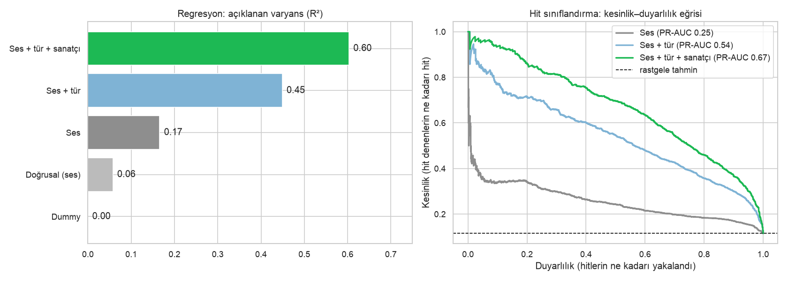
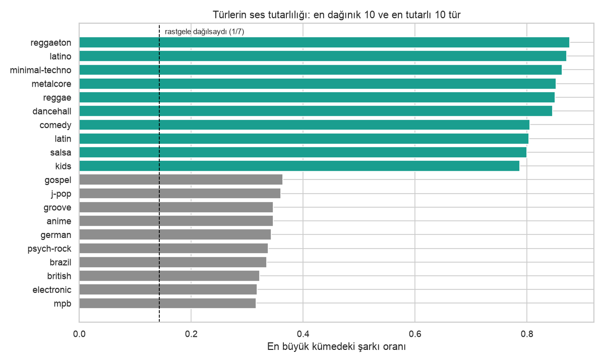
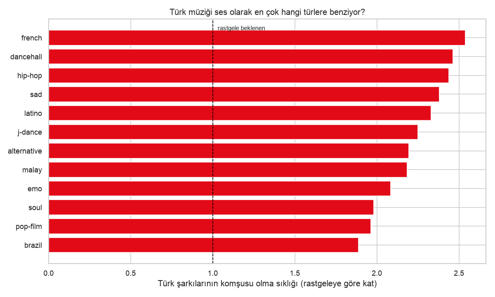
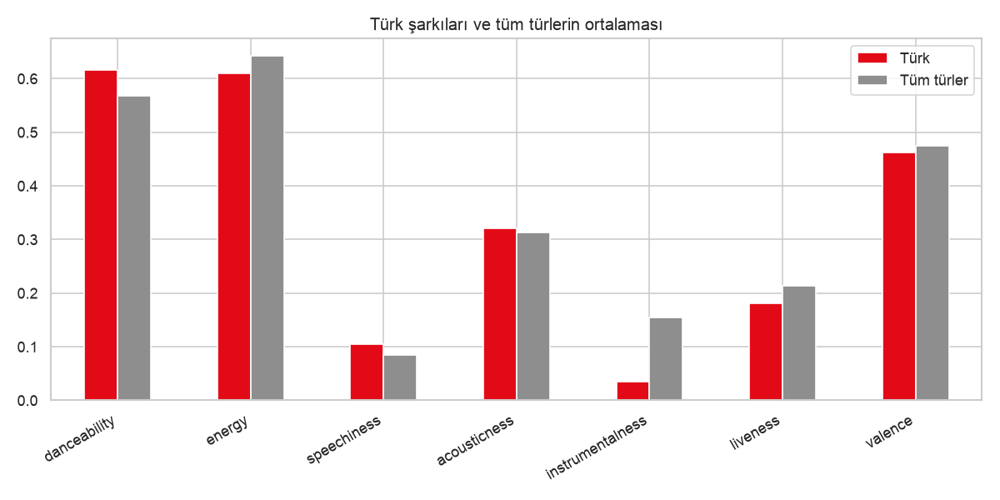

# Spotify Veri Madenciliği: Ses, Tür ve Popülerlik

[](https://github.com/AtakanTugrul/spotify-veri-madenciligi/actions/workflows/testler.yml)

81 bin Spotify şarkısının ses özellikleri (dans edilebilirlik, enerji, mutluluk, tempo…) üzerinde
keşif, kümeleme, popülerlik tahmini ve içerik tabanlı öneri. Türk müziğine ayrıca bakıldı.

**🎧 Canlı demo: Ses İkizi.** Bir şarkı seç, ses olarak en yakın şarkıları bul. Demo yayına
alınınca linki buraya eklenecek. Yerelde çalıştırmak için: `streamlit run app.py`.

Analiz notebook'ları 89.578 tekil şarkıyla çalışır; hit tahmini ve demo, aynı şarkının
farklı sürümleri birleştirildikten sonra kalan 81.056 şarkıyı kullanır.

## Öne çıkan bulgular

**1. Bir şarkının popülerliğini sesi değil, kimin söylediği belirliyor.** Yalnızca ses
özellikleriyle popülerliğin %17'si açıklanabiliyor. Tür eklenince %45'e, sanatçının diğer
şarkılarının popülerliği eklenince %60'a çıkıyor. Son modelin "en olası hit" dediği ilk %10'luk
dilimin %65'i gerçekten hit; rastgele seçimde bu oran %11,5.



**2. Ritimle tanımlanan türler sesle ayrışıyor, coğrafyayla tanımlananlar ayrışmıyor.** Şarkılar
ses özelliklerine göre 7 kümeye ayrıldı: sözsüz elektronik, sert ve enerjik, akustik ve sakin,
canlı kayıt, dans ve parti, konuşma, uyku/ambient. Reggaeton, latino ve minimal-techno
şarkılarının %85'ten fazlası tek bir kümede toplanıyor. "british", "german", "brazil" gibi ülke
etiketleri ise kümelere dağılıyor (%32–34). Bu etiketler bir ses tarifinden çok bir pazarı anlatıyor.



**3. Türk müziğinin ses ikizleri Fransız, dancehall ve hip-hop.** Benzer şarkı bulucuda Türk
şarkılarına önerilen komşuların türlerine bakıldı. Fransız, dancehall, hip-hop, "sad" ve latino
şarkıları rastgele beklenenden 2,3–2,5 kat sık çıkıyor. Uyku müziği, grindcore,
death/black metal ve İran müziği ise en uzak türler (rastgele beklenenin 0,01–0,21 katı).



**4. Ölçekleme küçük bir ayrıntı değil.** Önerilerin sorgu şarkısıyla aynı türden çıkma oranı
ölçeklemeyle %11,5, ölçekleme olmadan %6,8, rastgele seçimde %1. Ölçeklenmezse tempo (50–200 BPM)
uzaklığa hâkim oluyor ve öneriler "aynı hızdaki şarkılar"a dönüşüyor.

### Türk müziği, kısaca

| | Türk şarkıları | Tüm türler |
|---|---|---|
| "Dans ve parti" kümesinde | %44 | %32 |
| "Akustik ve sakin" kümesinde | %28 | %20 |
| Tür tutarlılığı (en büyük kümedeki pay) | %44 (114 tür içinde 81.) | medyan %53 |

Türk şarkıları ortalamadan biraz daha dans edilebilir ve konuşkan, enstrümantal parça oranı ise
çok düşük. Ses olarak tek bir kalıba sığmıyorlar: hem dans/parti hem de akustik uca ortalamadan
fazla şarkı düşüyor.



## Analiz

| Notebook | Ne yapıyor |
|---|---|
| [01_kesif](notebooks/01_kesif.ipynb) | Veri temizliği, dağılımlar, korelasyonlar, türlerin ve Türk müziğinin ses profili |
| [02_kumeleme](notebooks/02_kumeleme.ipynb) | K-Means (k seçimi: dirsek + silhouette), küme profilleri, PCA/t-SNE, tür tutarlılığı |
| [03_hit_tahmini](notebooks/03_hit_tahmini.ipynb) | HistGradientBoosting ile popülerlik regresyonu ve hit sınıflandırması, permütasyon önemi |
| [04_benzer_sarki](notebooks/04_benzer_sarki.ipynb) | İçerik tabanlı en yakın komşu önerisi, tür uyumu ile değerlendirme, Türk müziğinin komşuları |

**Dikkat edilen noktalar:**

- **Sürüm birleştirme.** Aynı şarkının single, albüm ve derleme sürümleri ayrı satırlar. Spotify
  dinlenmeleri genelde tek bir sürüme yazıyor, diğerleri 0'a yakın popülerlik alıyor. Bu sürümler
  birleştirilmezse model aynı sesi hem "hit" hem "0" olarak görür ve neredeyse aynı satırlar
  eğitim ile test arasında bölünür. Birleştirince 89.578 şarkı 81.056'ya iniyor.
- **Sızıntısız sanatçı kodlaması.** "Sanatçının ortalama popülerliği" özelliği out-of-fold
  hesaplanıyor ve az şarkısı olan sanatçılar genel ortalamaya doğru çekiliyor. Testler burada
  gerçek bir sızıntı buldu: yumuşatma ortalaması tüm eğitim verisinden alınıyordu. Düzeltildi ve
  bir şarkının kendi popülerliğini değiştirmenin kendi özelliğini değiştirmediğini doğrulayan bir
  test eklendi.
- **Yeni sanatçı testi.** Model, eğitimde hiç görmediği sanatçılarda ayrıca ölçüldü (R² 0,37).
  Böylece başarının ne kadarının sanatçıyı ezberlemekten geldiği görülebiliyor.

**Sınırlılıklar:**

- Popülerlik, verinin toplandığı andaki anlık bir değer.
- Derleme albüm kopyaları ünlü sanatçıların ortalamasını aşağı çekiyor. Örneğin Ed Sheeran'ın 15
  şarkısının 8'inin popülerliği 0.
- Kümeler belirgin değil (silhouette 0,16–0,25). Ses uzayı ayrık gruplardan çok sürekli bir yapı.
- Ses özellikleri dil ve kültür bilgisi taşımıyor.

## Proje yapısı

```
app.py       Streamlit demosu (Ses İkizi)
src/         Tekrar kullanılan kod: veri temizliği, özellikler, öneri, demo arayüzü
tests/       pytest; sentetik veriyle çalışır, gerçek CSV gerekmez
notebooks/   Analiz notebook'ları (01–04)
figures/     Notebook'ların ürettiği grafikler
scripts/     Demo veri dosyasını üreten betik
data/        Ham veri (repoda yok) + demo veri dosyası
```

## Kurulum

```bash
python3 -m venv .venv
source .venv/bin/activate
pip install -r requirements.txt   # demo ve testler
pytest
streamlit run app.py
```

Notebook'lar için ek paketleri kurun (`pip install -r requirements-notebooks.txt`) ve ham CSV'yi
Kaggle'dan indirip `data/dataset.csv` olarak kaydedin.

## Veri ve lisans

[Spotify Tracks Dataset](https://www.kaggle.com/datasets/maharshipandya/-spotify-tracks-dataset), Maharshi Pandya (Kaggle).
Veritabanı [Open Database License (ODbL)](https://opendatacommons.org/licenses/odbl/1-0/) ile
lisanslı. İçerik (şarkı ve sanatçı bilgileri) © ilgili hak sahipleri. Ses özellikleri Spotify
Web API'sinden alınmıştır.

Ham veri bu repoda yer almaz. Demo, ham veriden türetilmiş bir veritabanı kullanır
(`data/demo_sarkilar.csv.gz`: 81.056 şarkı, yalnızca öneri için gereken sütunlar). Bu dosya da ODbL ile lisanslıdır ve orijinalden farkları
[data/VERI_LISANSI.md](data/VERI_LISANSI.md) içinde anlatılır. Kod [MIT lisansı](LICENSE) ile
lisanslıdır. Bu proje Spotify ile ilişkili değildir.
